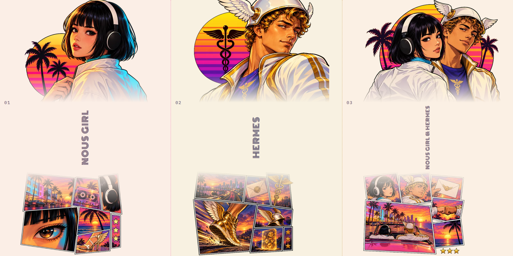

<div align="center">

  <a href="https://github.com/NousResearch/hermes-agent">
    
  </a>

  # Nous

  **Nous Research characters as 80s game heroes, for your Hermes desktop.**

  Themes for Hermes Desktop, painted like the loading screen of an open-world game: heavy ink outlines,
  a striped sunset sun, palm silhouettes and a collage of snapshots. Each character brings their own palette
  for light and dark mode, and the HERMES AGENT name glows like a neon sign.
  It starts with the Nous Girl, Hermes the messenger god, and the two of them together.

  <sub>FOR <a href="https://github.com/NousResearch/hermes-agent">HERMES DESKTOP</a> &nbsp;·&nbsp; COMMUNITY THEMES &nbsp;·&nbsp; VERSION 0.1.0</sub>

  <br /><br />

  [Try it in a minute](#try-it-in-a-minute) &nbsp;·&nbsp; [Meet the heroes](#meet-the-heroes) &nbsp;·&nbsp; [Switch any time](#switch-any-time)

</div>



## Try it in a minute

You need Hermes Desktop 0.22.2 or later. You don't need a terminal.

**1. Install.** In Hermes Desktop, open **Capabilities → Plugins** and click **Install from Git**. Paste this address, click **Review repository**, then install:

```text
https://github.com/Adolanium/hermes-nous
```

<details>
<summary>Prefer the terminal?</summary>

<br />

```sh
hermes plugins install Adolanium/hermes-nous
```

If it asks whether to enable the plugin, either answer works. That switch is for the agent side, and Nous has nothing there.

</details>

**2. Turn it on.** **Nous** now appears in **Capabilities → Plugins**. Flip its **Desktop** switch on. Desktop plugins installed from a package start turned off, and this is the step people miss.

**3. Pick a hero.** Type this in the message box and press Enter:

```text
/skin girl
```

The whole app changes on the spot, with no restart. Try `/skin hermes` next, or plain `/skin` to step through every theme you have.

## Meet the heroes

Click a card to see the full window.

| [](media/shots/girl.png?v=0.1.0) | [](media/shots/hermes.png?v=0.1.0) |
|:---:|:---:|
| [](media/shots/duo.png?v=0.1.0) | |

- **Nous Girl** (`girl`): black bob, blunt bangs and white headphones, reaching for a star over the sunset coast. Pastel cream and coral by day, neon pink and cyan by night.
- **Hermes** (`hermes`): the messenger god as a city courier, winged helmet, winged sneakers and a golden caduceus, sprinting the dusk freeway with a sealed message. Ivory and gold by day, deep violet and molten gold by night.
- **Nous Girl & Hermes** (`duo`): both leads on one cover, like a two-protagonist game. She reaches for the star, he raises the caduceus beside her. Cream with pink and gold by day, deep violet with neon pink and gold by night.

## Switch any time

Every Nous theme is a normal Hermes theme, so all the usual ways to switch work:

| Where | What to do |
| --- | --- |
| **Message box** | `/skin <name>`, for example `/skin hermes`. `/skin list` shows every theme; `/skin` alone moves to the next one. |
| **Command palette** | Press <kbd>Ctrl</kbd> <kbd>K</kbd> (<kbd>⌘</kbd> <kbd>K</kbd> on macOS), choose **Change theme**, and pick one. |
| **Settings** | **Settings → Appearance → Theme**. |

The names are `girl`, `hermes` and `duo`. To go back to the stock look, type `/skin nous`.

Hermes remembers your choice for each profile, so a work profile can keep Hermes while a personal one keeps the duo.

## Small decisions, already made

- **One install, every hero.** All the themes ship in a single plugin. There's nothing to choose at install time and nothing extra to download later.
- **Same picture, day or night.** Each theme has a light and a dark palette and follows your Hermes light/dark setting. The art is painted at sunset and cut out cleanly, so it looks the same on either ground.
- **A frame of its own.** The HERMES AGENT wordmark is a neon sign, rules are neon tubes from the character's two colours, the active tab lights up, and the empty chat opens with a small ★ NEW MISSION ★ card.
- **Sharp on any screen.** The art is painted at twice its display size, so it stays crisp on high-density displays.
- **Nothing leaves your machine.** The art and the fonts are packed into `plugin.js`, so themes switch instantly and work fully offline.
- **The chat stays readable.** The art lives in the sidebar and the empty new-session screen. Once a conversation starts, it's text on a calm ground.

## Update or remove

```sh
hermes plugins update hermes-nous
hermes plugins remove hermes-nous
```

Or use **Capabilities → Plugins**: switch **Nous** off to hide the themes, or remove it from there. If a Nous theme was active, Hermes goes back to its default theme.

## What it touches

- **Theme registration** through the Desktop plugin SDK, the same way any theme plugin adds itself to the picker.
- **Style rules** that apply only while a Nous theme is active, and disappear when you switch away.
- **Fonts**, bundled inside the plugin under the [SIL Open Font License](LICENSES): IBM Plex Sans and IBM Plex Mono for the interface, and Monoton for the neon wordmark.

It makes no network requests, adds no agent tools, hooks, background processes or settings, and reads none of your data.

The neon rules, the mission card and the placement of the art style Hermes Desktop's own markup, because the plugin SDK has no slots for decoration yet. If a Desktop update renames that markup, those touches fall back to the plain palette. Nothing else breaks.

## Compatibility

| Hermes Desktop | Platform | Status |
| --- | --- | --- |
| 0.22.2 | Windows 11 | Tested |
| 0.22.2 | macOS, Linux | Expected to work; not yet tested |

## More themes

Nous installs side by side with the god packs, and none of their theme names overlap, so every theme shows up in the same picker.

- **[Pantheon](https://github.com/Adolanium/hermes-pantheon)**: 18 Greek gods in dithered marble.
- **[Kemet](https://github.com/Adolanium/hermes-kemet)**: 12 Egyptian gods in painted relief and gold leaf.
- **[Asgard](https://github.com/Adolanium/hermes-asgard)**: Norse gods carved in runestone and wood.

<br />

<div align="center">
  <strong>Nous</strong><br />
  <sub>Pick a hero. Start the mission.</sub>
</div>

<br />

## License

[MIT](LICENSE). The bundled fonts are under the SIL Open Font License; see [LICENSES](LICENSES).

> **Community project**
>
> Nous is an independent community theme pack. It is not affiliated with, endorsed by, sponsored by, or officially associated with [Nous Research](https://github.com/NousResearch) or the [Hermes Agent project](https://github.com/NousResearch/hermes-agent). Hermes, Hermes Agent, and Nous Research are names and marks belonging to their respective owners. The characters are original artwork inspired by Nous Research; the loading-screen style is an homage to a genre, not to any one game.
